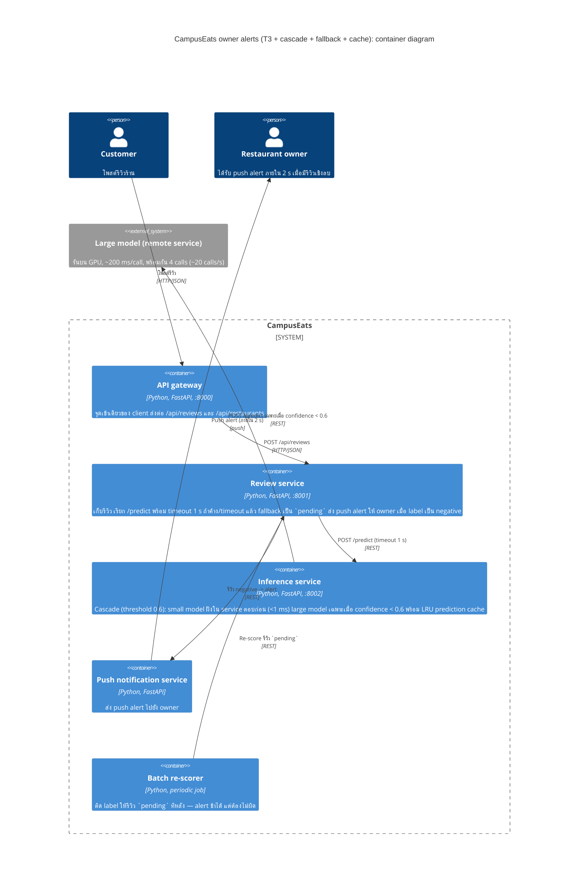

# Task 4: Deployment topologies and trade-offs

**Name / ชื่อ:** Rachata Kanitpunyacharoen

**Student ID / รหัสนิสิต:** 6632184921

This is **individual work**: each student completes and submits their own copy, in their own fork.

_งานนี้เป็น**งานเดี่ยว** นิสิตแต่ละคนทำและส่งงานของตัวเอง ใน fork ของตัวเอง_

**Scenario (A, B or C) / Scenario ที่เลือก:** A

Choose **one** scenario below. If the last digit of your student ID is odd, take A or B; if it is even, take B or C. Use your measurements from Tutorial 6 as evidence: cite run names from `results/runs.csv`. Answer in Thai or English.

เลือก scenario **หนึ่ง** ข้อด้านล่าง ถ้าเลขตัวสุดท้ายของรหัสนิสิตเป็นเลขคี่ ให้เลือก A หรือ B ถ้าเป็นเลขคู่ ให้เลือก B หรือ C ใช้ผลการวัดจาก tutorial ที่ทำไปเป็นข้อมูลอ้างอิง โดยอ้างชื่อ run จาก `results/runs.csv` จะตอบเป็นภาษาไทยหรือภาษาอังกฤษก็ได้

Facts that hold in every scenario / ข้อเท็จจริงที่ใช้กับทุก scenario:

- The large model serves at most **20 calls per second** (4 calls at once × about 200 ms each), and every call costs money.

    _large model รับได้สูงสุด **20 calls ต่อวินาที** (พร้อมกัน 4 calls × ประมาณ 200 ms ต่อ call) และทุก call มีค่าใช้จ่าย_

- The small model is fast and cheap enough to run anywhere, including inside the review service or on a kiosk, but it is much less accurate on its own.

    _small model เร็วและถูกพอที่จะรันที่ไหนก็ได้ รวมถึงภายใน review service หรือบน kiosk แต่ถ้าใช้ตัวเดียวจะแม่นน้อยกว่ามาก_

## Scenarios

**A. Owner alerts.** When a customer posts a negative review, the restaurant owner gets a push notification within **2 seconds**. At the lunch peak, CampusEats receives **40 reviews per second**. A missed alert is acceptable, but a wrong alert (for example, "your customer is unhappy" when they are happy) makes owners stop trusting alerts and, in the end, ignore them.

_เมื่อลูกค้าโพสต์รีวิวเชิงลบ เจ้าของร้านจะต้องได้รับ push notification ภายใน **2 วินาที** เวลาช่วงพีคตอนเที่ยง CampusEats ได้รับรีวิวจำนวน **40 รายการต่อวินาที** การพลาด alert ไปบ้างนั้นยอมรับได้ แต่ alert ที่ผิด (เช่น "ลูกค้าไม่พอใจ" ทั้งที่จริงๆ แล้วพอใจ) จะทำให้เจ้าของร้านไม่เชื่อถือและเลิกสนใจ alert ในที่สุด_

**B. Canteen kiosk.** A tablet in each canteen lets students leave a review on the spot. However, the canteen Wi-Fi is poor: the tablets lose their connection several times a day, for minutes at a time. The system must accept every review, even while a tablet is offline. Restaurant owners need the labels **by the end of the day**.

\*มี tablet ในแต่ละโรงอาหารให้นิสิตรีวิวได้ทันที อย่างไรก็ดี การเชื่อมต่อ Wi-Fi ในโรงอาหารไม่ดี ทำให้ tablet หลุดการเชื่อมต่อวันละหลายครั้ง ครั้งละหลายนาที ระบบจะต้องรับรีวิวได้ทุกรายการแม้ขณะที่กำลัง offline อยู่ และเจ้าของร้านต้องการ label **ภายในสิ้นวัน\***

**C. Weekly report.** Restaurant owners want a weekly sentiment report. Nothing in producing this report has to be real-time. **Accuracy matters most** and **cost must be minimal**.

\*เจ้าของร้านต้องการรายงาน sentiment รายสัปดาห์ ไม่มีอะไรที่จะต้องทำแบบ real-time ในการออกรายงานนี้ ความแม่นยำ **(accuracy) สำคัญที่สุด** และ **ค่าใช้จ่ายต้องน้อยที่สุด\***

## Topologies and patterns to choose from / Topology และ pattern ที่เลือกใช้ได้

|     | Topology                        | Where the model runs / โมเดลรันที่ไหน                                                                                                           |
| --- | ------------------------------- | ----------------------------------------------------------------------------------------------------------------------------------------------- |
| T1  | Model as a service, synchronous | Inference service, called for each review (today's baseline) _inference service ถูกเรียกทุกรีวิว (baseline ของวันนี้)_                       |
| T2  | Model as a library              | Inside the review service, or on the device _ภายใน review service หรือบนอุปกรณ์_                                                             |
| T3  | Hybrid                          | Small model locally, large model as a remote service _small model รันในเครื่อง large model เป็น remote service_                              |
| T4  | Asynchronous / batch            | Reviews are queued (broker, W10) or stored, and scored later in bulk _รีวิวถูกเข้าคิว (broker, W10) หรือเก็บไว้ แล้วติด label ทีหลังเป็นชุด_ |

Combine one topology with any of the patterns from Tutorial 6: **fallback**, **cascade** and **cache**.

\*เลือก topology หนึ่งแบบ แล้วผสมกับ pattern จาก Tutorial 6 ได้ตามต้องการ: **fallback**, **cascade** และ **cache\***

## 1. Quality requirements

The three most important quality requirements for your scenario, each with a number where possible.

_quality requirements ที่สำคัญที่สุด 3 ข้อของ scenario ที่เลือก ระบุตัวเลขเมื่อทำได้_

| #   | Quality         | Requirement                                                                                                                                                                                                                                    |
| --- | --------------- | ---------------------------------------------------------------------------------------------------------------------------------------------------------------------------------------------------------------------------------------------- |
| 1   | Latency         | รีวิวเชิงลบต้องส่ง push alert ถึง owner ภายใน **2 วินาที** แม้ในช่วงพีคเที่ยง **40 reviews/s** — p95 ของการติด label ทั้งระบบต้องไม่เกิน 2 s                                                                                                   |
| 2   | Alert precision | alert ที่ส่งต้องถูกอย่างน้อย **90%** (ผิดได้ไม่เกิน 10%, เกณฑ์เดียวกับ QR3) alert พลาดบ้างยอมรับได้ แต่ alert ผิด (เช่น บอกว่าลูกค้าไม่พอใจทั้งที่พอใจ) จะทำให้ owner ไม่เชื่อถือและเลิกสนใจ alert ในที่สุด — design ต้องยอม "พลาด" ก่อน "ผิด" |
| 3   | Capacity & cost | ช่วงพีคต้องใช้ large model ไม่เกิน **20 calls/s** (พร้อมกัน 4 × ~200 ms) และใช้ calls น้อยที่สุดตาม QR4 request ต้องไม่ fail (รีวิวเป็น `pending` ได้ แต่ต้องไม่หาย)                                                                           |

## 2. Design / การออกแบบ

Your topology, the patterns you add, and a container-level diagram (C4 level 2). The C4 diagram must be written in Mermaid.

_topology ที่เลือก pattern ที่เพิ่ม และ diagram ระดับ container (C4 level 2) เขียนด้วย Mermaid_

**Topology: T3 (Hybrid)** — small model รันฝังอยู่ใน inference service (ฟรี เร็ว) ส่วน large model เป็น remote service ที่เรียกเฉพาะเมื่อจำเป็น ผสมกับ pattern จาก Tutorial 6 ทั้งสามแบบ:

- **Cascade (threshold 0.6):** ทุกรีวิวให้ small model ตอบก่อน (< 1 ms, ฟรี) เฉพาะเมื่อ confidence ต่ำกว่า 0.6 จึงส่งต่อให้ large model ตาม run `t2-0.6` accuracy 91.5% ผ่านเกณฑ์ 90% แต่ cost ของ large model ลดจาก 100% เหลือ 38%
- **Fallback (timeout 1 s → `pending`):** ถ้า large model ค้างหรือ timeout review service จะบันทึกรีวิวเป็น `pending` แทนที่จะ fail หรือเดา label — `pending` คือ alert ที่**ช้า** (ซึ่ง scenario ยอมรับได้) ไม่ใช่ alert ที่**ผิด** (ซึ่ง scenario ให้อภัยไม่ได้) ตาม run `t1-after` errors เหลือ 0 แม้ large model ค้าง 10%
- **Cache (LRU):** รีวิวข้อความซ้ำตอบจาก cache ตาม run `t3-cache` cache hits 35% ที่ accuracy 93.0% เท่าเดิม ช่วงพีคเที่ยวนิสิตมักโพสต์รีวิวคล้ายกันบ่อย cache จึงช่วยลด large calls ลงอีก

review service ส่ง push alert เฉพาะรีวิวที่ label ท้ายสุดเป็น `negative` และ confidence สูงพอ alert ของรีวิว `pending` ส่งทีหลังโดย batch re-scorer — ไม่มี alert ใดตั้งอยู่บนการเดา

## 3. Evidence / หลักฐาน

Which runs support your choice? Show the numbers and, for scenario A, the capacity arithmetic: how many large-model calls per second does your design need at the peak?

_run ไหนที่สนับสนุนการตัดสินใจของนิสิต ให้นิสิตแสดงตัวเลขประกอบ และสำหรับ scenario A ให้นิสิตแสดงการคำนวณ capacity ด้วย เพื่อแสดงว่าในช่วงพีคนั้น design ของนิสิตต้องใช้ large model กี่ calls ต่อวินาที_

Runs จาก `results/runs.csv` (run ละ 200 รีวิว, ใช้ `--hang-rate 0.0` ทั้งหมด ยกเว้นระบุ):

| Run        | What it shows / แสดงอะไร                                                                                                                                                                                                                               |
| ---------- | ------------------------------------------------------------------------------------------------------------------------------------------------------------------------------------------------------------------------------------------------------ |
| `t0-large` | Baseline: 100% ของรีวิวไป large model — p50 494 ms, p95 595 ms, accuracy 93.5% นี่คือ T1 ซึ่งใช้เปรียบ capacity: ที่พีค 40 rev/s ต้องใช้ 40 large calls/s เกิน limit 20 calls/s (Little's law: 40×0.2 s = 8 concurrent > 4 workers) queue จะยาวไม่หยุด |
| `t0-small` | small model 100%: p50 11 ms แต่ accuracy เหลือ 72.5% ต่ำกว่าเกณฑ์ 90% มาก — ถ้าใช้ small model ตัวเดียว alert จะผิดบ่อยเกินไป                                                                                                                          |
| `t2-0.6`   | Cascade threshold 0.6: accuracy 91.5% (ผ่านเกณฑ์) cost ของ large model เหลือแค่ **38%** — คือ operating point ที่เลือก                                                                                                                                 |
| `t1-after` | Fallback ภายใต้ hang rate 10%: `errors` ลดจาก 20 (`t1-before`) เหลือ **0** รีวิว 26 ตัวที่ timeout กลายเป็น `pending` (alert ช้า) แทนที่จะ fail หรือถูกเดา และ p95 = 1013 ms < 2 s                                                                     |
| `t3-cache` | Cascade (0.6) + cache: 35% ของ requests ตอบจาก cache ที่ large calls 38% เท่าเดิมและ accuracy 93.0% — รีวิวซ้ำในช่วงพีคเที่ยงไม่เสียค่า large calls เลย                                                                                                |

**การคำนวณ capacity (พีค = 40 reviews/s, large model ≤ 20 calls/s, ~200 ms ต่อ call):**

- large-only (T1, run `t0-large`): 40 large calls/s > 20 → **ทำไม่ได้**
- cascade ที่ 0.6 (run `t2-0.6`, large_calls = 38%): 40 × 0.38 = **15.2 large calls/s** Little's law: 15.2 × 0.2 s = 3.04 concurrent < 4 workers → ระบบอยู่ใน steady state queue ไม่ยาว และ SLA 2 s ผ่าน (วัดได้ p95 = 544 ms ที่ load ทดสอบ)
- มี cache (run `t3-cache`) ทำให้สัดส่วน large calls ลดต่ำกว่า 38% ตอนมีรีวิวซ้ำ มี headroom เพิ่ม
- cascade ที่ 0.7 (run `t2-0.7`) จะกลายเป็น 40 × 0.53 = 21.2 calls/s > 20 — ทำไม่ได้ที่พีคทั้งที่ accuracy สูงกว่านิดหน่อย เลยเลือก threshold 0.6 ไม่ใช่ 0.7

## 4. ADR

Use the ADR format from W5.

_ใช้รูปแบบ ADR จาก W5_

**Title:** ใช้ topology แบบ hybrid (T3) — small model ฝังใน inference service, large model เป็น remote service — ผสม cascade threshold 0.6, fallback 1 s เป็น `pending`, และ LRU prediction cache สำหรับ scenario owner alerts

**Status:** Proposed

**Context:** ช่วงพีคเที่ยง CampusEats รับ 40 reviews/s แต่ large model รับได้แค่ 20 calls/s (พร้อมกัน 4 × ~200 ms) และทุก call มีค่าใช้จ่าย (QR4, QR5) alert ต้องถึง owner ภายใน 2 s alert พลาดยอมรับได้ แต่ alert ผิดจะทำให้ owner ไม่เชื่อถือตลอดไป เลยต้องเน้น precision (alert ถูก ≥ 90%) ก่อน recall ผลที่วัดใน Tutorial 6: `t0-large` (100% large calls, accuracy 93.5%, p95 595 ms) ทำไม่ได้ที่พีคเพราะต้อง 40 calls/s > 20; `t0-small` (accuracy 72.5%) แม่นน้อยเกินไป; cascade threshold 0.6 (`t2-0.6`) ได้ accuracy 91.5% ที่ large calls แค่ 38% (ที่พีคคือ 15.2 calls/s พอดี: 15.2 × 0.2 s = 3.04 concurrent < 4); fallback (`t1-after`) ทำให้ errors เหลือ 0 ตอน large model ค้าง 10% โดยคืน `pending` แทนการเดา; cache (`t3-cache`) ตัดงานซ้ำ 35% โดย accuracy เท่าเดิม

**Decision:** รัน small model ฝังใน inference service ส่วน large model เป็น remote service (T3) ทุกรีวิวให้ small model ตอบก่อน เฉพาะ confidence ต่ำกว่า 0.6 จึงส่งไป large model (cascade, threshold 0.6) review service รอคะแนนไม่เกิน 1 s ถ้า timeout/error แล้ว fallback เป็น `pending` (ไม่เดา ไม่ง้อ label ผิด) batch re-scorer จะติด label ให้รีวิว `pending` ทีหลัง รีวิวข้อความซ้ำตอบจาก LRU prediction cache push-notification service ส่ง alert เฉพาะ label `negative` ที่ confidence สูง

**Consequences:**

- Positive: ที่พีค 40 rev/s ใช้ large calls 15.2/s (≤ limit 20) ทั้ง capacity และ SLA 2 s ผ่าน (วัดได้ p95 544 ms ที่ load ทดสอบ และ ≤ 1013 ms แม้มี fallback 1 s) Cost ลดจากรีวิว 100% ไป large model เหลือ 38% และ cache ลดลงอีก accuracy 91.5% ผ่านเกณฑ์ precision fallback ทำให้ตอน large model เสียหายได้แต่ alert ช้า (ยอมรับได้) ไม่เคย alert ผิด (ให้อภัยไม่ได้) — `t1-after` errors 0 เทียบกับ `t1-before` errors 20
- Negative: 38% ของรีวิวต้องรอ latency ของ large model เลยช้ากว่า small-only (`t2-0.6` p95 544 ms; `t2-0.7` p50 383 ms) threshold 0.6 คือจุดที่ถูกรายที่สุดในเกณฑ์ 90% ถ้าขยับเป็น 0.7 accuracy ดีขึ้นแค่ 1.5 points แต่ capacity ที่พีคพัง (21.2 calls/s > 20) รีวิว `pending` ทำให้ alert ช้า — scenario ยอมรับได้ แต่ต้องดูแล batch re-scorer เพิ่ม

**Alternatives considered:** at least one topology you rejected, and why.

_อย่างน้อยหนึ่ง topology ที่ไม่เลือก และเหตุผล_

- **T1 (large model เป็น service, เรียกทุกรีวิวแบบ synchronous)** — ไม่เลือก: เป็น baseline ที่วัด (`t0-large`, 100% large calls) รับพีค 40 rev/s ไม่ทันภายใน limit 20 calls/s queue จะยาวไม่หยุดและ SLA 2 s พังตรงช่วงพีคพอดี
- **T2 (model เป็น library ใช้ small model ตัวเดียว เช่น ฝังใน review service หรือบน kiosk)** — ไม่เลือก: เร็วและฟรี (p50 11 ms ใน `t0-small`) แต่ accuracy เหลือ 72.5% ต่ำกว่าเกณฑ์ 90% มาก alert จะผิด 1 ใน 5 ซึ่งเป็น failure mode ที่ scenario บอกว่าจะทำให้ owner หยุดเชื่อ alert
- **T4 (queue ทั้งระบบ ติด label เป็น batch ทีหลัง)** — ไม่เลือกเป็น _primary_ path: batch ทำให้ SLA 2 s หายไปเลย (alert ทุกตัวมาหลัง window) เอาไว้เป็น _secondary_ path เท่านั้น (batch re-scorer สำหรับ `pending` reviews) ซึ่ง scenario ยอมรับสำหรับการ alert ที่พลาด

>
